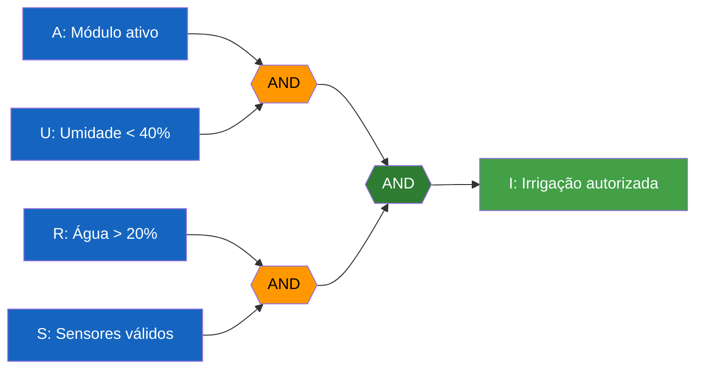

# SIFSM — SISTEMA INTEGRADO DE FUTURO SUSTENTÁVEL EM MARTE

## Circuito Lógico de Controle de Irrigação

**Projeto:** Aurora Siger  
**Sistema:** SIFSM  

---

# 1. INTRODUÇÃO

O Sistema Integrado de Futuro Sustentável em Marte (SIFSM) foi
desenvolvido para simular o gerenciamento inteligente dos recursos
e da infraestrutura da colônia Aurora Siger.

Uma das funcionalidades implementadas consiste no controle
automatizado da irrigação do módulo agrícola.

Considerando que a água é um recurso limitado em uma colônia
marciana, o sistema deve verificar determinadas condições antes
de autorizar a irrigação.

Para isso, foram utilizadas expressões booleanas e portas
lógicas, permitindo representar computacionalmente as
condições necessárias para o funcionamento do sistema.

O circuito desenvolvido utiliza portas lógicas AND e NOT,
garantindo que a irrigação somente seja autorizada quando
todas as condições de segurança estabelecidas forem atendidas.

---

# 2. OBJETIVO DO CIRCUITO LÓGICO

O objetivo do circuito é determinar automaticamente se o
sistema de irrigação da colônia deve ser autorizado ou
bloqueado.

A decisão considera quatro condições:

1. O módulo agrícola deve estar ativo.
2. A umidade deve estar abaixo de 40%.
3. O reservatório deve possuir mais de 20% de água.
4. Os sensores devem apresentar informações válidas.

Caso todas as condições sejam verdadeiras, a irrigação
será autorizada.

Caso uma ou mais condições sejam falsas, a irrigação
será bloqueada.

Os limites apresentados são valores hipotéticos,
utilizados exclusivamente para fins acadêmicos.

---

# 3. DEFINIÇÃO DAS VARIÁVEIS BOOLEANAS

As condições de funcionamento foram representadas por
variáveis booleanas.

Uma variável booleana pode assumir dois valores:

- 1 = Verdadeiro
- 0 = Falso

## 3.1 Variáveis de entrada

| Variável | Descrição | Condição verdadeira |
|----------|-----------|---------------------|
| A | Estado do módulo agrícola | Módulo ativo |
| U | Umidade do ambiente | Umidade < 40% |
| R | Disponibilidade de água | Reservatório > 20% |
| S | Integridade dos sensores | Sensores válidos |

## 3.2 Variável de saída

| Variável | Descrição | Resultado |
|----------|-----------|-----------|
| I | Autorização de irrigação | 1 = Autorizada / 0 = Bloqueada |

A saída depende diretamente da combinação das quatro
variáveis de entrada.

---

# 4. EXPRESSÃO BOOLEANA

A expressão lógica responsável pela autorização da
irrigação é:

**I = A ∧ U ∧ R ∧ S**

Onde:

- ∧ representa a operação lógica AND.
- A representa o módulo agrícola ativo.
- U representa a umidade abaixo do limite.
- R representa a disponibilidade de água.
- S representa a validade dos sensores.

A operação AND retorna verdadeiro somente quando
todas as entradas são verdadeiras.

Portanto:

**I = 1 somente quando A = U = R = S = 1.**

Em qualquer outra combinação, o resultado será:

**I = 0.**

---

# 5. REPRESENTAÇÃO DO CIRCUITO LÓGICO

O circuito foi desenvolvido utilizando três portas
lógicas AND.

As duas primeiras portas recebem pares de condições.

A terceira combina os resultados anteriores para
determinar a autorização final.

## 5.1 Diagrama com portas lógicas



## 5.2 Funcionamento das portas

**Primeira porta AND:**

Recebe as variáveis A e U.

Expressão:

P1 = A ∧ U

Verifica se o módulo agrícola está ativo e se
a umidade está abaixo do limite.

**Segunda porta AND:**

Recebe as variáveis R e S.

Expressão:

P2 = R ∧ S

Verifica se existe água suficiente e se os
sensores estão funcionando corretamente.

**Terceira porta AND:**

Recebe os resultados das duas portas anteriores.

Expressão:

I = P1 ∧ P2

Substituindo:

I = (A ∧ U) ∧ (R ∧ S)

Aplicando a propriedade associativa:

**I = A ∧ U ∧ R ∧ S**

O resultado final determina se a irrigação
será autorizada.

---

# 6. TABELA-VERDADE

A tabela-verdade apresenta todas as combinações
possíveis das quatro variáveis booleanas.

Como existem quatro entradas, temos:

2⁴ = 16 combinações possíveis.

| A | U | R | S | I |
|---|---|---|---|---|
| 0 | 0 | 0 | 0 | 0 |
| 0 | 0 | 0 | 1 | 0 |
| 0 | 0 | 1 | 0 | 0 |
| 0 | 0 | 1 | 1 | 0 |
| 0 | 1 | 0 | 0 | 0 |
| 0 | 1 | 0 | 1 | 0 |
| 0 | 1 | 1 | 0 | 0 |
| 0 | 1 | 1 | 1 | 0 |
| 1 | 0 | 0 | 0 | 0 |
| 1 | 0 | 0 | 1 | 0 |
| 1 | 0 | 1 | 0 | 0 |
| 1 | 0 | 1 | 1 | 0 |
| 1 | 1 | 0 | 0 | 0 |
| 1 | 1 | 0 | 1 | 0 |
| 1 | 1 | 1 | 0 | 0 |
| 1 | 1 | 1 | 1 | 1 |

## 6.1 Interpretação

A tabela demonstra que apenas uma das dezesseis
combinações possíveis autoriza a irrigação.

Essa combinação ocorre quando:

A = 1  
U = 1  
R = 1  
S = 1  

Consequentemente:

I = 1

Nas demais combinações, pelo menos uma condição
não foi atendida.

Portanto, a irrigação permanece bloqueada.

---

# 7. SIMPLIFICAÇÃO BOOLEANA

A álgebra booleana permite representar uma mesma
decisão utilizando diferentes expressões lógicas.

No circuito desenvolvido, podemos representar
a condição de bloqueio da irrigação utilizando
a operação NOT.

## 7.1 Expressão de bloqueio

A irrigação será bloqueada quando pelo menos
uma das condições necessárias não for atendida.

Assim:

**B = ¬A ∨ ¬U ∨ ¬R ∨ ¬S**

Onde:

- ¬ representa NOT.
- ∨ representa OR.
- B representa o bloqueio da irrigação.

## 7.2 Aplicação do Teorema de De Morgan

O Teorema de De Morgan estabelece que:

¬(A ∧ B) = ¬A ∨ ¬B

Aplicando essa propriedade às quatro variáveis:

B = ¬A ∨ ¬U ∨ ¬R ∨ ¬S

Podemos escrever:

**B = ¬(A ∧ U ∧ R ∧ S)**

Como a autorização é o contrário do bloqueio:

I = ¬B

Substituindo:

I = ¬[¬(A ∧ U ∧ R ∧ S)]

Aplicando a propriedade da dupla negação:

¬(¬X) = X

Obtemos:

**I = A ∧ U ∧ R ∧ S**

## 7.3 Resultado da simplificação

A expressão final é:

**I = A ∧ U ∧ R ∧ S**

Essa expressão mantém exatamente o mesmo
comportamento lógico da regra original.

A simplificação demonstra que a autorização
pode ser representada diretamente por uma
conjunção das quatro condições.

Isso facilita a implementação em Python,
a interpretação do circuito e a verificação
de seu funcionamento.

---

# 8. IMPLEMENTAÇÃO EM PYTHON

A expressão booleana foi implementada no
sistema SIFSM utilizando uma função Python.

```python
def verificar_irrigacao(
    modulo_ativo,
    umidade,
    nivel_agua,
    sensores_validos
):

    # Verifica a umidade
    umidade_baixa = umidade < 40

    # Verifica a disponibilidade de água
    agua_disponivel = nivel_agua > 20

    # Expressão booleana
    irrigacao = (
        modulo_ativo
        and umidade_baixa
        and agua_disponivel
        and sensores_validos
    )

    return irrigacao
```

## 8.1 Explicação do código

A função recebe quatro parâmetros:

- modulo_ativo: informa se o módulo está ativo.
- umidade: percentual atual de umidade.
- nivel_agua: percentual disponível no reservatório.
- sensores_validos: informa se os sensores são confiáveis.

O programa verifica as condições estabelecidas
e utiliza o operador `and` para combinar
as variáveis booleanas.

O resultado será:

True: irrigação autorizada.

False: irrigação bloqueada.

---

# 9. EXEMPLOS DE EXECUÇÃO

## 9.1 Cenário 1 — Irrigação autorizada

Dados simulados:

| Parâmetro | Valor |
|-----------|-------|
| Módulo ativo | True |
| Umidade | 35% |
| Reservatório | 55% |
| Sensores válidos | True |

Execução:

```python
resultado = verificar_irrigacao(
    True,
    35,
    55,
    True
)

if resultado:
    print("IRRIGAÇÃO AUTORIZADA")
else:
    print("IRRIGAÇÃO BLOQUEADA")
```

Saída:

```text
IRRIGAÇÃO AUTORIZADA
```

### Análise

Todas as condições foram atendidas.

O módulo está ativo, a umidade está abaixo
do limite, existe água suficiente e os
sensores apresentam dados válidos.

Portanto, a irrigação é autorizada.

---

## 9.2 Cenário 2 — Irrigação bloqueada por falta de água

Dados simulados:

| Parâmetro | Valor |
|-----------|-------|
| Módulo ativo | True |
| Umidade | 30% |
| Reservatório | 15% |
| Sensores válidos | True |

Execução:

```python
resultado = verificar_irrigacao(
    True,
    30,
    15,
    True
)

print(
    "IRRIGAÇÃO AUTORIZADA"
    if resultado
    else "IRRIGAÇÃO BLOQUEADA"
)
```

Saída:

```text
IRRIGAÇÃO BLOQUEADA
```

### Análise

Apesar de a umidade estar abaixo do limite,
o reservatório apresenta apenas 15% de água.

Como o mínimo estabelecido exige um nível
superior a 20%, a condição R é falsa.

Consequentemente, o circuito retorna
o valor lógico 0.

---

## 9.3 Cenário 3 — Falha nos sensores

Dados simulados:

| Parâmetro | Valor |
|-----------|-------|
| Módulo ativo | True |
| Umidade | 32% |
| Reservatório | 70% |
| Sensores válidos | False |

Execução:

```python
resultado = verificar_irrigacao(
    True,
    32,
    70,
    False
)

print(
    "IRRIGAÇÃO AUTORIZADA"
    if resultado
    else "IRRIGAÇÃO BLOQUEADA"
)
```

Saída:

```text
IRRIGAÇÃO BLOQUEADA
```

### Análise

Embora exista água suficiente e a umidade
esteja abaixo do limite, os sensores
não apresentam informações válidas.

A variável S assume o valor 0.

Como a operação AND exige todas as entradas
verdadeiras, a irrigação permanece bloqueada.

---

# 10. IMPORTÂNCIA DO CIRCUITO PARA A COLÔNIA

O circuito lógico contribui para o gerenciamento
inteligente dos recursos da Aurora Siger.

Sua principal finalidade é evitar que a
irrigação seja autorizada em condições
inadequadas.

Entre os benefícios esperados estão:

- Redução do desperdício de água.
- Melhor controle dos recursos disponíveis.
- Automação de decisões operacionais.
- Verificação das condições dos sensores.
- Padronização das regras de funcionamento.
- Maior transparência das decisões automatizadas.

A utilização de expressões booleanas também
facilita a manutenção do sistema.

Caso seja necessário alterar os limites
de umidade ou disponibilidade de água,
as condições poderão ser ajustadas no código.

Entretanto, o circuito representa apenas
uma simulação acadêmica.

Em uma aplicação real, seriam necessários
mecanismos adicionais de segurança,
redundância de sensores, validação de dados
e supervisão humana.

---

# 11. RELAÇÃO COM A SUSTENTABILIDADE

A sustentabilidade é um dos principais
objetivos do projeto Aurora Siger.

Em uma colônia localizada em Marte,
a disponibilidade de recursos naturais
seria limitada.

A água utilizada na agricultura precisaria
ser armazenada, monitorada e reutilizada
sempre que possível.

Nesse contexto, a automação do sistema
de irrigação permite demonstrar como
regras computacionais podem contribuir
para a utilização responsável dos recursos.

O circuito lógico evita a autorização
de irrigação quando não existe água
suficiente ou quando os sensores
apresentam falhas.

Dessa forma, o sistema está relacionado
aos princípios ESG, especialmente:

**Ambiental:**
uso consciente da água e redução
de desperdícios.

**Social:**
preservação dos recursos necessários
à alimentação e ao bem-estar da tripulação.

**Governança:**
utilização de regras claras,
verificáveis e documentadas para
orientar decisões automatizadas.

---

# 12. CONCLUSÃO

O circuito lógico de irrigação desenvolvido
para o SIFSM demonstra a aplicação prática
da álgebra booleana no gerenciamento
automatizado de uma infraestrutura.

A utilização de portas lógicas AND permite
combinar diferentes condições operacionais
e produzir uma decisão objetiva.

A tabela-verdade comprova que a irrigação
somente será autorizada quando todas
as condições forem atendidas.

A aplicação do Teorema de De Morgan
demonstra a equivalência entre as expressões
de autorização e bloqueio.

A implementação em Python permite executar
a lógica desenvolvida e verificar seu
comportamento utilizando dados simulados.

Assim, o circuito contribui para os objetivos
do projeto Aurora Siger, demonstrando como
a lógica computacional pode auxiliar
na automação, no gerenciamento de recursos
e na sustentabilidade de uma colônia marciana.

---

**Projeto:** SIFSM — Aurora Siger  
**Documento:** Circuito Lógico de Controle de Irrigação  
**Finalidade:** Atividade Integradora — Simulação Acadêmica
