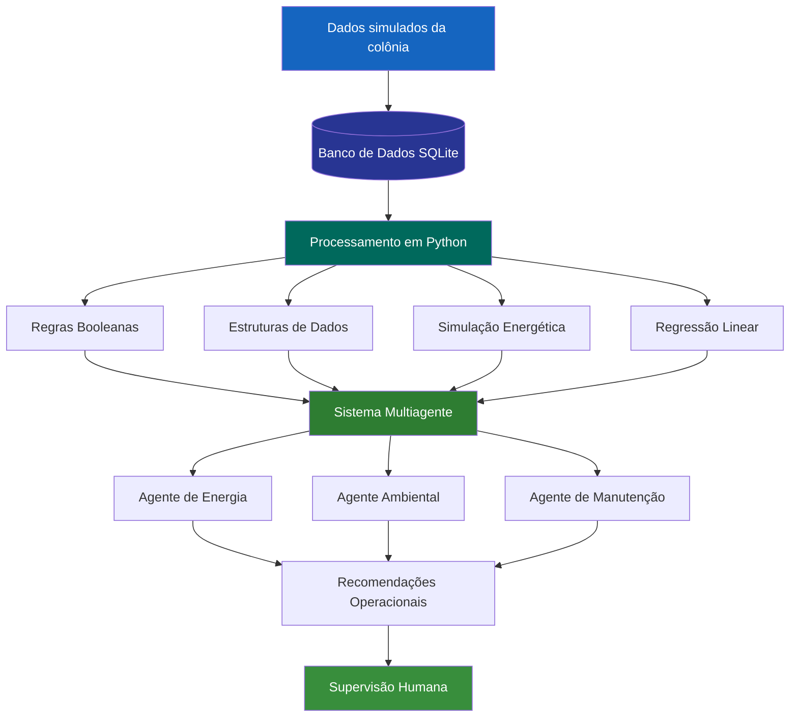

# SIFSM — SISTEMA INTEGRADO DE FUTURO SUSTENTÁVEL EM MARTE

## RELATÓRIO TÉCNICO

**Projeto:** Aurora Siger  
**Sistema:** SIFSM  
**Linguagem de programação:** Python  
**Banco de dados:** SQLite  
**Área:** Engenharia de Software e Sistemas Inteligentes

---

# 1. INTRODUÇÃO

A exploração espacial representa um dos maiores desafios
tecnológicos da humanidade, exigindo soluções capazes de
integrar diferentes áreas do conhecimento.

Em uma possível colônia humana em Marte, o gerenciamento
eficiente dos recursos disponíveis seria fundamental para
garantir a continuidade das operações e a segurança
dos habitantes.

Nesse contexto, foi desenvolvido o Sistema Integrado de
Futuro Sustentável em Marte (SIFSM), pertencente à missão
fictícia Aurora Siger.

O projeto consiste em um protótipo computacional
desenvolvido em Python, capaz de simular operações
relacionadas à infraestrutura de uma colônia marciana.

O sistema integra conceitos de:

- Banco de dados e linguagem SQL;
- Operações CRUD;
- Estruturas de dados;
- Algoritmos de busca em grafos;
- Álgebra booleana;
- Circuitos lógicos;
- Modelagem matemática;
- Cálculo integral e integração numérica;
- Regressão linear;
- Aprendizado de máquina;
- Sistemas multiagentes;
- Arquitetura computacional;
- Sustentabilidade e governança ESG.

O objetivo é demonstrar como esses conhecimentos
podem ser utilizados em conjunto para construir
um sistema de apoio à tomada de decisões.

Todos os dados utilizados são simulados e possuem
finalidade exclusivamente acadêmica.

---

# 2. OBJETIVOS DO PROJETO

## 2.1 Objetivo geral

Desenvolver um sistema computacional integrado
capaz de representar, monitorar e analisar
o funcionamento operacional da colônia Aurora Siger,
utilizando recursos de programação, armazenamento
de dados, automação e modelagem matemática.

## 2.2 Objetivos específicos

O projeto busca:

1. Organizar informações da colônia em um banco
   de dados relacional.

2. Implementar operações de cadastro, consulta,
   atualização e exclusão de módulos.

3. Aplicar estruturas de dados para organizar
   solicitações, alertas e conexões.

4. Utilizar expressões booleanas para simular
   decisões operacionais.

5. Representar circuitos utilizando portas lógicas.

6. Simular geração, consumo e armazenamento de energia.

7. Aplicar integração numérica para calcular
   variações energéticas.

8. Desenvolver um modelo de regressão linear
   para estimar o consumo futuro.

9. Implementar agentes inteligentes simulados
   para análise de informações.

10. Relacionar o funcionamento do sistema
    aos princípios de sustentabilidade e governança.

---

# 3. ARQUITETURA GERAL DO SISTEMA

O SIFSM foi desenvolvido utilizando uma arquitetura
modular, na qual diferentes funcionalidades são
organizadas em funções Python.

Essa abordagem facilita a compreensão, manutenção
e evolução do projeto.

O sistema possui quatro componentes principais:

- Camada de armazenamento;
- Camada de processamento;
- Camada de análise e decisão;
- Camada de interação com o usuário.

## 3.1 Camada de armazenamento

Responsável por armazenar informações operacionais
da colônia.

Utiliza um banco de dados SQLite e arquivos CSV.

## 3.2 Camada de processamento

Responsável pela execução das funções Python,
consultas SQL, algoritmos e cálculos matemáticos.

## 3.3 Camada de análise e decisão

Responsável por interpretar os dados e produzir
recomendações utilizando regras booleanas,
simulações energéticas e regressão linear.

## 3.4 Camada de interação

Responsável pela comunicação com o usuário
por meio de um menu executado no terminal.

## 3.5 Representação da arquitetura



O fluxo demonstra como informações armazenadas
podem ser processadas e transformadas em
recomendações operacionais.

---

# 4. BANCO DE DADOS E SQL

O banco de dados do SIFSM foi desenvolvido
utilizando SQLite.

O SQLite é um sistema de gerenciamento de
banco de dados relacional que permite executar
comandos SQL diretamente em uma aplicação Python.

Sua utilização foi escolhida por apresentar:

- Simplicidade de implementação;
- Baixo consumo de recursos;
- Armazenamento persistente;
- Integração com Python;
- Ausência de necessidade de servidor externo.

## 4.1 Organização das tabelas

O banco de dados possui três tabelas principais.

### Tabela `modulos`

Responsável por armazenar os módulos da colônia.

| Campo | Tipo | Descrição |
|---|---|---|
| id | INTEGER | Identificador único |
| nome | TEXT | Nome do módulo |
| tipo | TEXT | Categoria operacional |
| consumo_kw | REAL | Consumo energético |
| prioridade | INTEGER | Prioridade operacional |
| status | TEXT | Estado de funcionamento |

### Tabela `leituras_sensores`

Responsável por armazenar informações simuladas
sobre as condições operacionais da colônia.

| Campo | Tipo | Descrição |
|---|---|---|
| id | INTEGER | Identificador da leitura |
| modulo_id | INTEGER | Referência ao módulo |
| ciclo_horas | REAL | Tempo da simulação |
| geracao_kw | REAL | Potência gerada |
| consumo_kw | REAL | Potência consumida |
| umidade_percentual | REAL | Umidade simulada |
| agua_percentual | REAL | Reserva de água |
| temperatura_c | REAL | Temperatura |
| sensores_validos | INTEGER | Validade dos sensores |

### Tabela `alertas`

Responsável pelo armazenamento de ocorrências
que necessitam de acompanhamento.

| Campo | Tipo | Descrição |
|---|---|---|
| id | INTEGER | Identificador do alerta |
| modulo_id | INTEGER | Módulo relacionado |
| descricao | TEXT | Descrição da ocorrência |
| prioridade | INTEGER | Nível de prioridade |
| status | TEXT | Situação do alerta |

## 4.2 Relacionamento entre tabelas

As tabelas utilizam chaves primárias e estrangeiras.

A tabela `modulos` possui relacionamento com
`leituras_sensores` e `alertas`.

Isso permite identificar quais registros estão
associados a cada módulo.

## 4.3 Operações CRUD

O sistema implementa as quatro operações
fundamentais de gerenciamento de dados.

### CREATE

Permite cadastrar novos módulos.

```sql
INSERT INTO modulos
(nome, tipo, consumo_kw, prioridade, status)
VALUES
('Novo Módulo', 'pesquisa', 20, 3, 'ativo');
```

### READ

Permite consultar os registros existentes.

```sql
SELECT *
FROM modulos;
```

### UPDATE

Permite atualizar informações.

```sql
UPDATE modulos
SET consumo_kw = 25
WHERE nome = 'Novo Módulo';
```

### DELETE

Permite excluir registros.

```sql
DELETE FROM modulos
WHERE nome = 'Novo Módulo';
```

As operações são executadas por funções Python
que utilizam a biblioteca `sqlite3`.

O banco também possui restrições para evitar
determinados valores inválidos.

---

# 5. ESTRUTURAS DE DADOS

O SIFSM utiliza diferentes estruturas de dados
para organizar e processar informações.

Cada estrutura foi escolhida conforme a
necessidade da funcionalidade implementada.

## 5.1 Listas

As listas armazenam conjuntos de valores
e resultados de operações.

São utilizadas principalmente na análise
de dados históricos e na regressão linear.

Exemplo:

```python
consumo = [250, 258, 270, 285, 295, 300]
```

Essa estrutura permite percorrer os valores
e realizar operações matemáticas.

## 5.2 Dicionários

Os dicionários armazenam informações
organizadas por chaves e valores.

No projeto, são utilizados para representar
as conexões entre os módulos da colônia.

Exemplo:

```python
grafo = {
    "Habitação": [
        "Suporte Médico",
        "Produção de Oxigênio"
    ]
}
```

## 5.3 Filas

As filas seguem o princípio FIFO:

First In, First Out.

O primeiro elemento inserido será
o primeiro elemento atendido.

No SIFSM, essa estrutura organiza
solicitações operacionais.

Exemplo:

```python
from collections import deque

fila = deque()

fila.append("Verificar comunicação")
fila.append("Consultar energia")

proxima = fila.popleft()
```

Nesse exemplo, a primeira solicitação
será atendida antes da segunda.

A fila do protótipo é mantida em memória
durante a execução.

## 5.4 Heap

O heap é utilizado para organizar
alertas conforme sua prioridade.

No sistema, a biblioteca `heapq`
permite identificar rapidamente
os alertas prioritários.

Exemplo:

```python
import heapq

alertas = []

heapq.heappush(alertas, (-5, "Falha crítica"))
heapq.heappush(alertas, (-3, "Manutenção"))

prioritario = heapq.heappop(alertas)
```

O valor negativo permite tratar
prioridades maiores como mais urgentes.

## 5.5 Grafos

Os grafos representam conexões entre
diferentes módulos da infraestrutura.

Cada módulo representa um vértice.

Cada conexão representa uma aresta.

Essa estrutura permite estudar caminhos
e relacionamentos dentro da colônia.

## 5.6 Algoritmo BFS

O algoritmo Breadth-First Search,
ou busca em largura, percorre o grafo
por níveis de proximidade.

No SIFSM, o BFS permite encontrar
um caminho com o menor número de
conexões entre dois módulos.

Por exemplo:

Armazenamento de Energia
→ Habitação
→ Suporte Médico

O BFS considera as conexões sem pesos.

Portanto, encontra o menor número de arestas,
mas não necessariamente a rota de menor
consumo energético ou menor distância física.

---

# 6. REGRAS BOOLEANAS E AUTOMAÇÃO

O SIFSM utiliza expressões booleanas
para representar decisões operacionais.

Uma das funcionalidades implementadas
consiste no controle simulado da irrigação.

A irrigação somente poderá ser autorizada
quando quatro condições forem atendidas:

1. O módulo agrícola estiver ativo;
2. A umidade estiver abaixo de 40%;
3. O reservatório possuir mais de 20% de água;
4. Os sensores estiverem válidos.

## 6.1 Expressão booleana

A regra é representada por:

**I = A ∧ U ∧ R ∧ S**

Onde:

- I = Irrigação autorizada;
- A = Módulo ativo;
- U = Umidade baixa;
- R = Água disponível;
- S = Sensores válidos.

O operador AND exige que todas
as condições sejam verdadeiras.

## 6.2 Regra de bloqueio

A irrigação será bloqueada caso
alguma condição não seja atendida.

A expressão é:

**B = ¬A ∨ ¬U ∨ ¬R ∨ ¬S**

Aplicando o Teorema de De Morgan:

**B = ¬(A ∧ U ∧ R ∧ S)**

Consequentemente:

**I = ¬B**

Aplicando a dupla negação:

**I = A ∧ U ∧ R ∧ S**

Essa representação demonstra a
equivalência entre a condição de
autorização e a negação do bloqueio.

## 6.3 Implementação em Python

```python
def verificar_irrigacao(
    modulo_ativo,
    umidade,
    nivel_agua,
    sensores_validos
):

    umidade_baixa = umidade < 40
    agua_disponivel = nivel_agua > 20

    irrigacao = (
        modulo_ativo
        and umidade_baixa
        and agua_disponivel
        and sensores_validos
    )

    return irrigacao
```

## 6.4 Exemplo de execução

Dados simulados:

| Variável | Valor |
|---|---|
| Módulo ativo | True |
| Umidade | 35% |
| Reservatório | 55% |
| Sensores válidos | True |

Resultado:

```text
IRRIGAÇÃO AUTORIZADA NA SIMULAÇÃO.
```

O sistema utiliza uma regra determinística,
baseada em condições previamente estabelecidas.

Essa decisão não representa o acionamento
de equipamentos físicos.

---

# 7. MODELAGEM MATEMÁTICA DA ENERGIA

O gerenciamento energético é uma das
principais funcionalidades do SIFSM.

A simulação considera:

- Potência gerada;
- Potência consumida;
- Capacidade de armazenamento;
- Energia disponível;
- Eficiência de carregamento.

## 7.1 Saldo de potência

O saldo de potência é calculado pela diferença
entre geração e consumo.

A função utilizada é:

$$
P_{saldo}(t) = P_{gerada}(t) - P_{consumida}(t)
$$

Onde:

- P_saldo representa o saldo de potência;
- P_gerada representa a potência gerada;
- P_consumida representa a potência consumida;
- t representa o tempo.

Quando:

**P_gerada > P_consumida**

Existe potência excedente disponível.

Quando:

**P_gerada < P_consumida**

Existe um déficit energético.

## 7.2 Energia acumulada

Para calcular a variação de energia
durante determinado intervalo,
utilizamos a integral:

$$
\Delta E =
\int_{t_0}^{t_1} P_{saldo}(t)\,dt
$$

A potência é medida em kW.

O tempo é medido em horas.

Consequentemente, a energia é
expressa em kWh.

## 7.3 Integração numérica

Como os dados são discretos,
o sistema utiliza a regra dos trapézios.

A aproximação é:

$$
\Delta E \approx
\sum_{i=0}^{n-1}
\frac{P_i + P_{i+1}}{2}
(t_{i+1}-t_i)
$$

Essa fórmula permite estimar a energia
a partir dos saldos de potência
registrados ao longo do tempo.

## 7.4 Parâmetros da bateria

A simulação utiliza:

| Parâmetro | Valor |
|---|---|
| Capacidade máxima | 800 kWh |
| Energia inicial | 400 kWh |
| Eficiência de carregamento | 95% |

Quando existe excedente energético,
a energia armazenada é atualizada
considerando a eficiência de carregamento.

Quando existe déficit,
a energia armazenada diminui.

A reserva é limitada ao intervalo
entre 0 e 800 kWh.

O modelo não considera todas as perdas
físicas possíveis, como degradação
da bateria e eficiência de descarga.

## 7.5 Dados utilizados

| Ciclo (h) | Geração (kW) | Consumo (kW) |
|---|---:|---:|
| 0 | 240 | 250 |
| 1 | 260 | 258 |
| 2 | 290 | 270 |
| 3 | 310 | 285 |
| 4 | 320 | 295 |
| 5 | 300 | 300 |
| 6 | 280 | 315 |
| 7 | 270 | 325 |

## 7.6 Análise dos resultados

Nos primeiros ciclos, a geração
de energia aumenta.

Entre os ciclos 2 e 4,
a geração supera o consumo,
permitindo o armazenamento de excedentes.

Nos ciclos seguintes,
o consumo continua aumentando
enquanto a geração diminui.

Isso provoca um déficit energético
nos últimos ciclos.

Utilizando os parâmetros estabelecidos
e a integração numérica implementada,
a reserva final estimada é:

**400,95 kWh.**

O resultado representa uma variação
líquida positiva de aproximadamente
0,95 kWh em relação à reserva inicial.

Apesar disso, os últimos ciclos
apresentam tendência de déficit,
o que exige atenção ao consumo futuro.

## 7.7 Aplicação na colônia

A modelagem permite:

- Identificar períodos de déficit;
- Estimar a evolução das reservas;
- Avaliar a necessidade de economia;
- Planejar o armazenamento de energia;
- Apoiar decisões operacionais.

---

# 8. REGRESSÃO LINEAR E PREVISÃO

O SIFSM utiliza regressão linear simples
para estimar o consumo energético futuro.

A regressão busca identificar uma relação
aproximadamente linear entre o tempo
e o consumo energético.

## 8.1 Modelo matemático

A função utilizada é:

$$
\hat{C}(t) = a + bt
$$

Onde:

- C(t) representa o consumo estimado;
- a representa o intercepto;
- b representa a inclinação da reta;
- t representa o ciclo operacional.

## 8.2 Ajuste do modelo

O sistema utiliza dados históricos
de consumo energético.

Os primeiros registros são utilizados
para ajustar o modelo.

Os dois últimos registros são reservados
para avaliação.

O coeficiente angular é calculado por:

$$
b =
\frac{
\sum (x_i-\bar{x})(y_i-\bar{y})
}{
\sum (x_i-\bar{x})^2
}
$$

O intercepto é:

$$
a = \bar{y} - b\bar{x}
$$

Essas expressões permitem calcular
os parâmetros da regressão linear
sem bibliotecas externas.

## 8.3 Avaliação das previsões

O sistema utiliza três métricas.

### Erro absoluto médio (MAE)

$$
MAE =
\frac{1}{n}
\sum_{i=1}^{n}
|y_i-\hat{y}_i|
$$

### Erro quadrático médio (MSE)

$$
MSE =
\frac{1}{n}
\sum_{i=1}^{n}
(y_i-\hat{y}_i)^2
$$

### Raiz do erro quadrático médio (RMSE)

$$
RMSE = \sqrt{MSE}
$$

Essas métricas permitem comparar
as previsões com os valores observados.

Quanto menores os erros,
melhor o ajuste aos dados avaliados.

## 8.4 Interpretação

O modelo identifica uma tendência
de crescimento do consumo energético
durante os ciclos simulados.

Essa informação pode auxiliar
no planejamento das reservas.

Entretanto, a regressão linear
não garante que o consumo continuará
crescendo na mesma proporção.

Como os dados são simulados e a
amostra é pequena, os resultados
possuem finalidade didática.

---

# 9. SISTEMA MULTIAGENTE

O SIFSM possui uma simulação de
agentes inteligentes especializados.

O objetivo é demonstrar como diferentes
componentes computacionais podem
analisar informações e produzir
recomendações específicas.

O projeto utiliza três agentes.

## 9.1 Agente de Energia

Responsável por analisar:

- Potência gerada;
- Potência consumida;
- Possíveis déficits energéticos.

Quando o consumo supera a geração,
o agente recomenda reduzir cargas
não essenciais.

Exemplo:

```text
AGENTE ENERGÉTICO:
Recomenda reduzir cargas não essenciais.
```

## 9.2 Agente Ambiental

Responsável por analisar:

- Umidade;
- Disponibilidade de água;
- Condições ambientais simuladas.

Quando identifica baixa umidade,
o agente recomenda avaliar
a necessidade de irrigação.

Exemplo:

```text
AGENTE AMBIENTAL:
Recomenda avaliar irrigação.
```

## 9.3 Agente de Manutenção

Responsável por consultar
os alertas operacionais.

O agente identifica a ocorrência
pendente com maior prioridade.

Exemplo:

```text
AGENTE DE MANUTENÇÃO:
Prioridade 4 - Monitorar condições
ambientais da agricultura.
```

## 9.4 Coordenador de agentes

O sistema possui uma função
responsável por executar
os agentes especializados.

Essa organização representa
uma forma simplificada de coordenação
e encaminhamento de tarefas.

O conceito de handoff consiste
em direcionar uma atividade
ao agente mais adequado.

No protótipo, esse processo
é simulado por chamadas de funções.

## 9.5 Limitações dos agentes

Os agentes não utilizam modelos
generativos de linguagem.

Suas respostas são produzidas
por regras determinísticas.

Portanto, o sistema demonstra
a organização de agentes especializados,
mas não implementa uma inteligência
artificial generativa real.

---

# 10. GUARDRAILS E SEGURANÇA

Guardrails são mecanismos utilizados
para estabelecer limites e controles
sobre o comportamento de sistemas
automatizados.

No SIFSM, as regras de segurança
buscam evitar recomendações
baseadas em condições inadequadas.

Um exemplo é a validação dos
sensores antes de autorizar
a irrigação simulada.

Se os sensores forem inválidos,
a operação será bloqueada.

Além disso, o sistema apresenta
uma mensagem informando que
as recomendações críticas dependem
de supervisão humana.

Essas medidas demonstram
a importância da responsabilidade
no desenvolvimento de sistemas
automatizados.

Entretanto, o protótipo não possui
certificação de segurança nem
mecanismos suficientes para controlar
equipamentos reais.

---

# 11. ARQUITETURA COMPUTACIONAL

O funcionamento de um sistema
inteligente depende da interação
entre software e hardware.

O SIFSM foi desenvolvido para
execução em computadores convencionais,
utilizando principalmente a CPU.

## 11.1 CPU

A Unidade Central de Processamento
é responsável pela execução
das instruções do programa.

No SIFSM, a CPU executa:

- Código Python;
- Consultas SQL;
- Estruturas condicionais;
- Algoritmos;
- Cálculos matemáticos.

## 11.2 GPU

A Unidade de Processamento Gráfico
é especializada em determinadas
operações paralelas.

Em uma versão mais avançada,
poderia acelerar simulações
e cálculos de maior complexidade.

## 11.3 NPU

A Unidade de Processamento Neural
é projetada para acelerar
operações relacionadas a
modelos de inteligência artificial.

Poderia ser utilizada em versões
futuras com modelos locais de IA.

## 11.4 TPU

A Unidade de Processamento Tensorial
é um acelerador especializado
em operações utilizadas por
determinados modelos de
aprendizado de máquina.

## 11.5 Memória RAM

A memória RAM armazena
temporariamente informações
utilizadas durante a execução.

No projeto, estruturas como listas,
dicionários e filas são mantidas
na memória durante o processamento.

## 11.6 Armazenamento

O armazenamento persistente
permite preservar informações
mesmo após o encerramento
do programa.

O banco SQLite utiliza
um arquivo para armazenar
os registros da colônia.

## 11.7 Barramentos

Os barramentos permitem
a transferência de dados
entre componentes computacionais.

São fundamentais para a
comunicação entre processador,
memória e dispositivos.

## 11.8 Chiplets

Chiplets são blocos de circuitos
integrados que podem ser combinados
em um mesmo encapsulamento.

Essa abordagem permite desenvolver
arquiteturas computacionais modulares.

## 11.9 Relação com a missão

Em uma missão espacial,
o consumo energético do hardware
seria uma preocupação importante.

Por isso, algoritmos simples,
armazenamento eficiente
e processamento otimizado
podem contribuir para
a redução do consumo computacional.

O protótipo utiliza CPU convencional.
As demais arquiteturas são
apresentadas como possibilidades
tecnológicas, não como componentes
efetivamente utilizados.

---

# 12. SUSTENTABILIDADE E ESG

O projeto Aurora Siger considera
a sustentabilidade como um princípio
fundamental para o funcionamento
de uma colônia humana em Marte.

A sigla ESG representa três dimensões:

- Environmental (Ambiental);
- Social (Social);
- Governance (Governança).

## 12.1 Dimensão ambiental

A dimensão ambiental envolve
a utilização responsável dos recursos.

Na colônia, seria necessário
controlar cuidadosamente:

- Energia;
- Água;
- Materiais;
- Resíduos;
- Recursos naturais disponíveis.

O SIFSM contribui para essa
perspectiva ao simular
a geração e o consumo energético.

O sistema também apresenta
recomendações para reduzir
desperdícios e utilizar
recursos de maneira eficiente.

## 12.2 Dimensão social

A dimensão social está relacionada
à segurança, qualidade de vida
e bem-estar da tripulação.

Em uma colônia marciana,
sistemas como habitação,
suporte médico e produção
de oxigênio seriam essenciais.

Por isso, decisões de economia
não deveriam comprometer
o funcionamento desses módulos.

A automação deve considerar
as necessidades humanas
e evitar decisões discriminatórias.

## 12.3 Governança

A governança envolve
transparência, responsabilidade
e critérios claros de decisão.

No SIFSM, as regras operacionais
são implementadas diretamente
no código Python.

Isso permite compreender
quais condições levam
a determinadas recomendações.

Entretanto, decisões críticas
devem permanecer sujeitas
à supervisão humana.

## 12.4 Eficiência energética

O gerenciamento energético
é fundamental para reduzir
o desperdício de recursos.

O sistema permite comparar
geração e consumo e identificar
situações de déficit.

Também demonstra como
a energia excedente pode
ser direcionada ao armazenamento.

## 12.5 Sustentabilidade computacional

O processamento computacional
também consome energia.

Portanto, a escolha de algoritmos
e estruturas de dados eficientes
contribui para o uso responsável
dos recursos computacionais.

No protótipo, foram utilizadas
bibliotecas padrão do Python
e modelos matemáticos simples.

Essa escolha reduz a complexidade
de execução e facilita
a manutenção do sistema.

---

# 13. SIMULAÇÕES E RESULTADOS

O SIFSM permite executar
diferentes funcionalidades
por meio de um menu interativo.

## 13.1 Consulta de módulos

O usuário pode visualizar
os módulos cadastrados.

Exemplo:

```text
===== MÓDULOS DA COLÔNIA =====

Nome: Habitação
Consumo: 35.0 kW
Prioridade: 5
Status: ativo
```

## 13.2 Decisão energética

Considerando os dados
do último ciclo:

```text
Geração: 270 kW
Consumo: 325 kW
```

O sistema identifica:

```text
ALERTA: consumo maior que geração.
```

## 13.3 Controle de irrigação

Considerando:

```text
Umidade: 35%
Água: 55%
Sensores válidos: Sim
Módulo agrícola: Ativo
```

O resultado será:

```text
IRRIGAÇÃO AUTORIZADA NA SIMULAÇÃO.
```

## 13.4 Simulação energética

O sistema calcula a evolução
da energia armazenada.

A reserva inicial é:

```text
400 kWh
```

Após os ciclos simulados,
a reserva estimada é:

```text
400,95 kWh
```

## 13.5 Regressão linear

O sistema ajusta um modelo
de previsão do consumo.

Também apresenta as métricas
MAE, MSE e RMSE.

Esses indicadores permitem
avaliar a qualidade das previsões
nos registros reservados para teste.

## 13.6 Agentes inteligentes

O sistema executa três agentes:

```text
AGENTE ENERGÉTICO:
Recomenda reduzir cargas não essenciais.

AGENTE AMBIENTAL:
Recomenda avaliar irrigação.

AGENTE DE MANUTENÇÃO:
Monitorar condições ambientais da agricultura.
```

As mensagens demonstram
como diferentes componentes
podem analisar os dados
e apresentar recomendações.

---

# 14. LIMITAÇÕES DO PROJETO

O SIFSM foi desenvolvido
como um protótipo acadêmico.

Portanto, apresenta algumas limitações.

## 14.1 Dados simulados

Os registros utilizados
não foram obtidos de sensores reais.

Os valores representam
cenários hipotéticos.

## 14.2 Modelagem simplificada

A simulação energética
não considera todos os fatores
físicos de uma infraestrutura real.

## 14.3 Previsão limitada

A regressão utiliza
uma pequena quantidade
de dados históricos.

Por isso, não deve ser utilizada
como previsão operacional real.

## 14.4 Agentes determinísticos

Os agentes utilizam regras
previamente definidas.

Não possuem capacidade
de aprendizado contínuo
nem integração com IA generativa.

## 14.5 Segurança operacional

O sistema não está conectado
a equipamentos físicos.

As recomendações apresentadas
não representam autorizações
para operações reais.

---

# 15. POSSIBILIDADES DE EVOLUÇÃO

O projeto poderá ser expandido
em futuras etapas.

Entre as melhorias possíveis estão:

1. Integração com sensores reais
   em ambientes controlados.

2. Desenvolvimento de uma
   interface gráfica.

3. Implementação de modelos
   preditivos mais avançados.

4. Persistência das filas
   e solicitações operacionais.

5. Integração entre a rede
   de módulos e o banco de dados.

6. Implementação de algoritmos
   de otimização energética.

7. Desenvolvimento de agentes
   com integração opcional
   a modelos de linguagem.

8. Criação de painéis
   de monitoramento.

9. Inclusão de mecanismos
   adicionais de auditoria
   e segurança.

10. Simulação de novos cenários
    de sustentabilidade.

---

# 16. CONCLUSÃO

O desenvolvimento do Sistema Integrado
de Futuro Sustentável em Marte (SIFSM)
permitiu integrar diferentes conceitos
estudados ao longo da formação acadêmica.

O projeto demonstrou como banco de dados,
estruturas de dados, algoritmos,
álgebra booleana, modelagem matemática
e sistemas multiagentes podem ser
utilizados em uma aplicação integrada.

A utilização de Python e SQLite
possibilitou desenvolver um protótipo
organizado, modular e executável
sem dependência de bibliotecas avançadas.

As funcionalidades implementadas
permitem representar operações
de uma colônia marciana,
organizar informações,
analisar condições energéticas
e produzir recomendações.

A simulação energética demonstrou
a importância de acompanhar
a relação entre geração,
consumo e armazenamento.

A regressão linear apresentou
uma aplicação introdutória
de aprendizado de máquina,
permitindo estimar tendências
de consumo.

Os agentes inteligentes simulados
demonstraram uma forma de
organização de componentes
especializados em diferentes
áreas operacionais.

Além dos aspectos técnicos,
o projeto destacou a importância
da sustentabilidade,
da transparência e da
responsabilidade humana
no desenvolvimento de
sistemas automatizados.

Dessa forma, o SIFSM representa
uma aplicação acadêmica
que reúne conhecimentos
de computação, matemática
e governança tecnológica
em um cenário de exploração espacial.

---

# 17. ARQUIVOS DO PROJETO

O sistema é composto pelos seguintes arquivos:

| Arquivo | Finalidade |
|---|---|
| codigo_fonte.py | Sistema principal |
| simulacao_computacional.py | Execução das simulações |
| banco_aurora_siger.sql | Estrutura do banco |
| dados_aurora_siger.csv | Dados simulados |
| circuito_logico.pdf | Documentação do circuito |
| relatorio_tecnico.md | Relatório técnico |
| README.md | Instruções do projeto |
| link_video.txt | Link da apresentação |

O banco de dados SQLite é criado
automaticamente na primeira execução.

---

# 18. EXECUÇÃO DO SISTEMA

Para executar o projeto,
é necessário possuir Python 3.

Os arquivos devem permanecer
na mesma pasta.

## 18.1 Sistema principal

```bash
python codigo_fonte.py
```

## 18.2 Simulação computacional

```bash
python simulacao_computacional.py
```

Na primeira execução,
o banco de dados será
inicializado automaticamente.

O sistema utiliza somente
bibliotecas padrão do Python.

---

# 19. CONSIDERAÇÕES FINAIS

O SIFSM demonstra que a integração
de diferentes áreas da computação
permite desenvolver soluções
capazes de organizar informações
e apoiar decisões.

Mesmo utilizando dados simulados
e modelos simplificados,
o projeto apresenta conceitos
importantes para o desenvolvimento
de sistemas inteligentes.

A proposta também reforça
que a evolução tecnológica
deve estar acompanhada
de responsabilidade social,
eficiência energética
e governança transparente.

---

**Projeto:** Aurora Siger  
**Sistema:** SIFSM  
**Documento:** Relatório Técnico  
**Finalidade:** Atividade Integradora — Simulação Acadêmica
